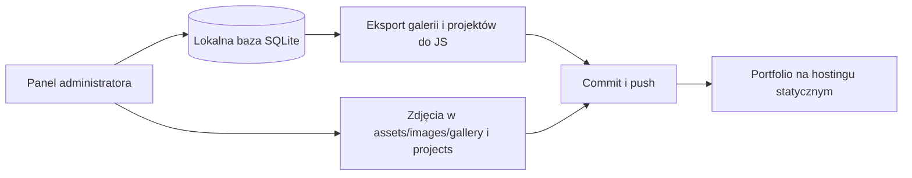

<div align="center">

# Marcin Podyma · Portfolio

**Kod, fotografia i pomysły — w jednym miejscu.**

Responsywne portfolio z niebieskim motywem, interaktywną galerią<br />
i własnym panelem do zarządzania treścią.


[Wyróżniki](#wyrozniki) · [Uruchomienie](#start) · [Panel admina](#panel) · [Publikacja](#publikacja) · [Kontrola projektu](#kontrola)

</div>

---

Portfolio łączy projekty i kompetencje z fotografią oraz zainteresowaniami po godzinach. Strona główna prezentuje osiągnięcia i aktualne prace, a osobne podstrony prowadzą do korepetycji, hobby i kontaktu. Treści galerii i projektów można zmieniać z panelu administratora, bez ręcznej edycji HTML.

<a id="wyrozniki"></a>

## ✨ Co wyróżnia stronę

| Rozwiązanie | Jak działa |
| :--- | :--- |
| **Poświata dopasowana do zdjęcia** | Canvas analizuje kolorystykę fotografii i wybiera dominujący odcień do neonowej poświaty w lightboxie. Czerwone światło sceny daje inną aurę niż niebieskie. Wyniki są buforowane, a zapisany kolor stanowi wariant zapasowy. |
| **Zmiana motywu jak fala** | Przejście między baby blue i navy blue rozchodzi się od góry ekranu dzięki View Transitions API. Ikona księżyca płynnie zmienia się w słońce. |
| **Aurora w tle** | Powoli przesuwające się, rozmyte poświaty są widoczne na wszystkich podstronach i w panelu. Paleta dopasowuje się do jasnego baby blue i ciemnego granatu. |
| **Kreator wiadomości** | Cztery kroki prowadzą od e-maila, przez temat i dopasowane szczegóły, do edytowalnej wiadomości. Lokalne API zapisuje ją w prywatnej skrzynce panelu. |
| **Nawigacja zamieniająca się w wyspę** | Podczas przewijania na komputerze pasek skraca się do samych linków. Na telefonie logo otwiera animowane menu. |
| **Galeria z poziomym przewijaniem** | Filtry pozwalają wybrać koncerty, naturę, ludzi lub miejsca. Powtarzane zestawy zdjęć tworzą wrażenie przewijania w pętli. |
| **Swipe & Info Bottom** | Na telefonie otwarte zdjęcia tworzą karuzelę ze scroll snap. Paginacja i szczegóły znajdują się pod fotografią oraz aktualizują po przesunięciu. |
| **Kafelki dopasowane do treści** | Karty projektów rozwijają szczegóły po najechaniu lub dotknięciu. Przy nieparzystej liczbie wpisów ostatni kafelek zajmuje pełną szerokość siatki na komputerze. |
| **Jedna treść, dwa sposoby publikacji** | Lokalnie strona korzysta z API i SQLite. Panel równolegle eksportuje dane do plików JS, które pozwalają wyświetlać portfolio na hostingu statycznym. |

### Detale, które budują całość

- **Glassmorphism** — półprzezroczyste elementy, rozmycie i delikatne ramki w obu motywach.
- **Spójne przyciski** — wspólne style w `assets/css/controls.css`: szklane gradienty, neonowe kapsułki i delikatne powiększenie na hover. Przełączniki w navbarze zachowują minimalistyczny wygląd, a przycisk Instagrama w Hobby ma własny kolorowy gradient.
- **PL / EN** — przełączanie języka oraz zapamiętywanie języka i motywu w przeglądarce.
- **Czytelna metryczka** — koncerty mają artystę, wydarzenie, miejsce i datę; pozostałe kategorie pokazują miejsce oraz opcjonalny opis.
- **Oznaczenie modela** — zdjęcia w kategorii Ludzie mogą zawierać opcjonalny link do profilu na Instagramie, ustawiany w panelu.
- **Projekty ze zdjęciami** — fotografia jest wyświetlana w całości, a tytuł i krótki opis znajdują się na przyciemnionym gradiencie. Rozwijane szczegóły zachowują spójne, ciemne tło.
- **Dopasowanie tekstu** — Container Queries i skalowanie czcionki pomagają zmieścić długie wartości w kartach lightboxa.
- **Obsługa klawiatury** — strzałki zmieniają zdjęcia, Escape zamyka modal; po zamknięciu fokus wraca do galerii.
- **Mniej ruchu na życzenie** — strona uwzględnia ustawienie `prefers-reduced-motion`.
- **Szybki kontakt** — pływający przycisk prowadzi do kontaktu, a w sekcji powitalnej można pobrać CV.

<a id="start"></a>

## 🚀 Uruchomienie lokalne

**Wymagania:** Node.js 24 lub nowszy. Projekt korzysta z wbudowanych modułów Node.js, w tym SQLite — nie wymaga instalowania pakietów npm.

W folderze repozytorium uruchom:

```sh
npm start
```

Na Windows możesz też użyć skryptu, który wybierze lokalny runtime z `.local/`, jeśli jest dostępny:

```powershell
powershell -ExecutionPolicy Bypass -File .\scripts\start-gallery.ps1
```

| Widok | Adres lokalny |
| :--- | :--- |
| Portfolio | [localhost:3000](http://localhost:3000) |
| Hobby i fotografia | [localhost:3000/hobby.html](http://localhost:3000/hobby.html) |
| Korepetycje | [localhost:3000/knowledge.html](http://localhost:3000/knowledge.html) |
| Kontakt | [localhost:3000/contact.html](http://localhost:3000/contact.html) |
| Panel administratora | [localhost:3000/admin.html](http://localhost:3000/admin.html) |

Serwer nasłuchuje na `127.0.0.1`. Zatrzymasz go przez **Ctrl + C** w terminalu. Skrypt [stop-gallery.ps1](scripts/stop-gallery.ps1) służy do zatrzymania instancji uruchomionej w tle i zapisanej w pliku PID.

<a id="panel"></a>

## 🛠️ Panel administratora

Na komputerze panel otwiera kliknięcie logo. Na telefonie stuknij logo dwukrotnie; pojedyncze stuknięcie rozwija menu.

Przy pierwszym wejściu ustaw własne hasło dla loginu **`admin`** — minimum 10 znaków. Panel ma zakładki **Galeria zdjęć**, **Projekty** i **Wiadomości**:

| Zakładka | Dostępne możliwości |
| :--- | :--- |
| **Galeria zdjęć** | Dodawanie i usuwanie zdjęć, edycja tytułu, kategorii, miejsca i opisu; metryczka koncertu oraz opcjonalne oznaczenie modela na Instagramie. Teksty mogą mieć wersję angielską. Nowe zdjęcia są zmniejszane do maks. 2400 px. |
| **Projekty** | Dodawanie, edycja i usuwanie wpisów; tytuł, opisy, technologie, link, rok i symbol. Wybór sekcji oraz dodawanie, podmiana lub usuwanie zdjęcia. Opcjonalna wersja angielska. |
| **Wiadomości** | Przeglądanie zgłoszeń, oznaczanie jako przeczytane, odpowiedź w aplikacji pocztowej oraz sprawdzanie i ponawianie powiadomień e-mail. |

Hasło jest przechowywane jako skrót **scrypt z losową solą**. Sesja używa ciasteczka `HttpOnly` i `SameSite=Strict`, trwa do 8 godzin i wygasa po restarcie serwera. Operacje zmieniające dane wymagają logowania oraz zgodnego nagłówka `Origin`.

Zakładka **Wiadomości** pokazuje zgłoszenia z kreatora kontaktowego, licznik nieprzeczytanych oraz status powiadomienia pocztowego. Treść wiadomości pozostaje prywatna i nie trafia do eksportów ani Git. Powiadomienia e-mail wymagają lokalnej konfiguracji `.env`; instrukcja znajduje się w [CONTACT-MESSAGES.md](CONTACT-MESSAGES.md).

Panel i API służą do pracy lokalnej. Na hostingu statycznym można przeglądać wyeksportowane treści; zarządzanie nimi oraz przyjmowanie wiadomości odbywa się przez lokalny serwer.

<a id="publikacja"></a>

## 📦 Od panelu do GitHuba



Po zapisaniu zmian panel aktualizuje pliki:

- `assets/js/gallery-data.js` — zdjęcia i ich metryczki.
- `assets/js/projects-data.js` — projekty i kompetencje.
- `assets/images/gallery/` — zdjęcia galerii, dodane ręcznie lub przez panel.
- `assets/images/projects/` — zdjęcia projektów dodane przez panel.

**Publikacja wymaga commita i pusha.** Panel nie wysyła zmian automatycznie na GitHub. Po skonfigurowaniu GitHub Pages strona może korzystać z eksportów bez uruchomionego backendu.

Baza w `data/`, hasło administratora, prywatne wiadomości, konfiguracja `.env` oraz lokalny runtime w `.local/` są wykluczone z Git. Szablon `.env.example`, eksporty i zdjęcia są uwzględniane w repozytorium. Usunięcie wpisu z panelu pozostawia jego zdjęcie na dysku. Szczegóły pracy z bazą i kopii zapasowych opisuje [LOCAL-GALLERY.md](LOCAL-GALLERY.md).

## 🗂️ Struktura projektu

```text
├── index.html              # Portfolio: projekty i kompetencje
├── knowledge.html          # Korepetycje
├── hobby.html              # Hobby, galeria i lightbox
├── contact.html            # Kontakt i kreator wiadomości
├── admin.html              # Panel: galeria, projekty, wiadomości
├── server.cjs              # Lokalny serwer, API i SQLite
├── inbox.cjs               # Prywatna skrzynka i powiadomienia e-mail
├── .env.example            # Szablon lokalnej konfiguracji poczty
├── assets/
│   ├── css/                # Style podstron; controls.css — wspólne przyciski
│   ├── js/                 # Interakcje, panel i eksporty danych
│   └── images/
│       ├── profile/        # Portret i stałe zdjęcia profilowe
│       ├── gallery/        # Wszystkie zdjęcia galerii Hobby
│       └── projects/       # Zdjęcia projektów
├── data/                   # Lokalna baza — poza Git
├── scripts/                # Uruchamianie i kontrola projektu
└── tests/                  # Testy API, danych i eksportów
```

<a id="kontrola"></a>

## ✅ Sprawdzanie projektu

```sh
npm run check
npm test
```

- `check` sprawdza składnię JavaScript i modułów serwera, odnośniki, kotwice, identyfikatory HTML, konfigurację JSON oraz eksporty i zdjęcia galerii i projektów.
- `test` weryfikuje zapis i trwałość danych, eksporty, logowanie, kontrolę dostępu, operacje na zdjęciach i projektach oraz skrzynkę wiadomości, ponawianie powiadomień i limity zgłoszeń. Testy korzystają z osobnych, tymczasowych baz; powiadomienia pocztowe w teście skrzynki są symulowane.

Zasady formatowania znajdują się w [.editorconfig](.editorconfig) i [.prettierrc.json](.prettierrc.json).

---

<div align="center">

**Marcin Podyma** · [Instagram @47.cinek](https://www.instagram.com/47.cinek/)

</div>
